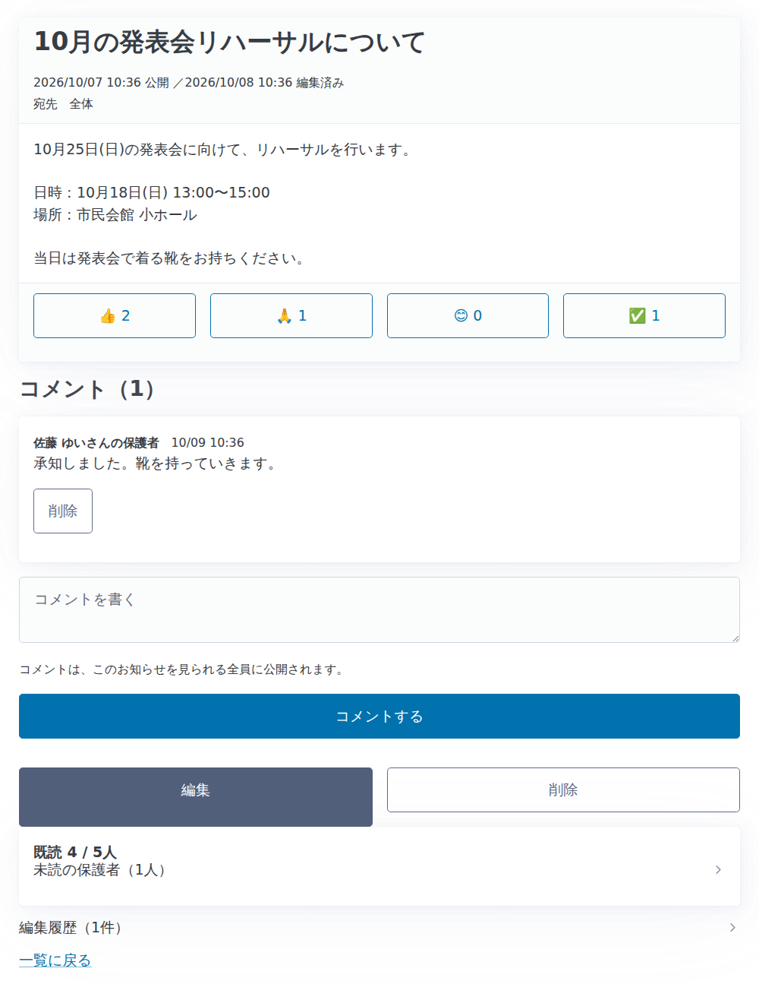
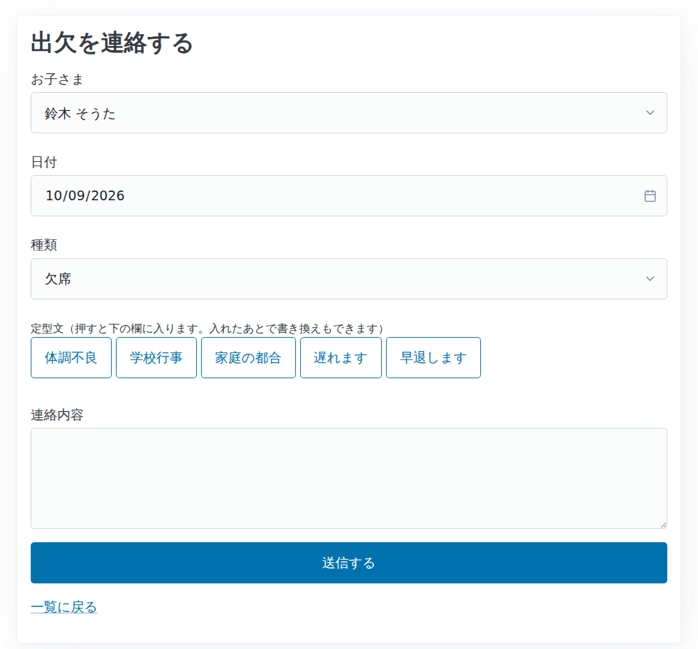
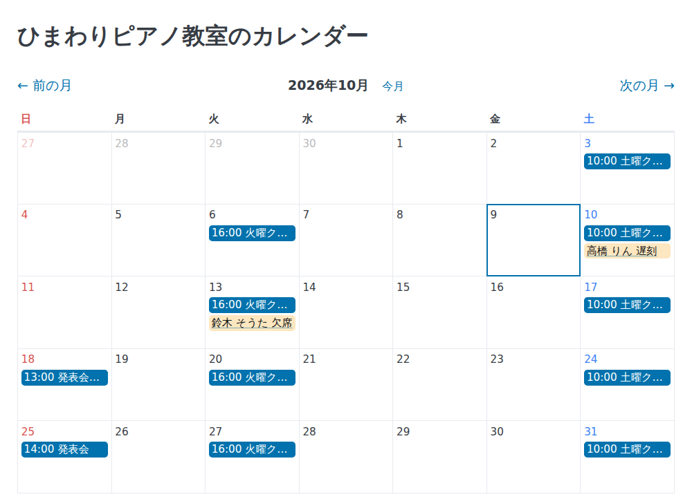
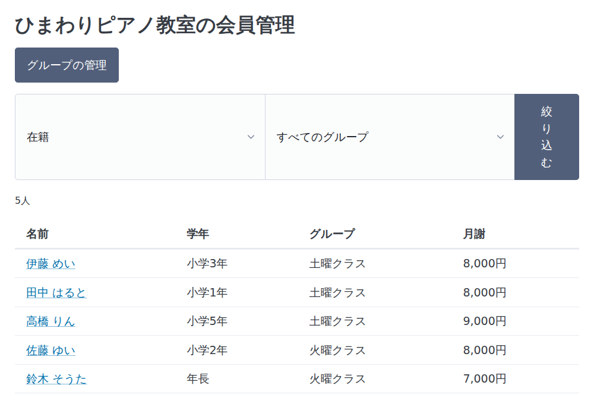
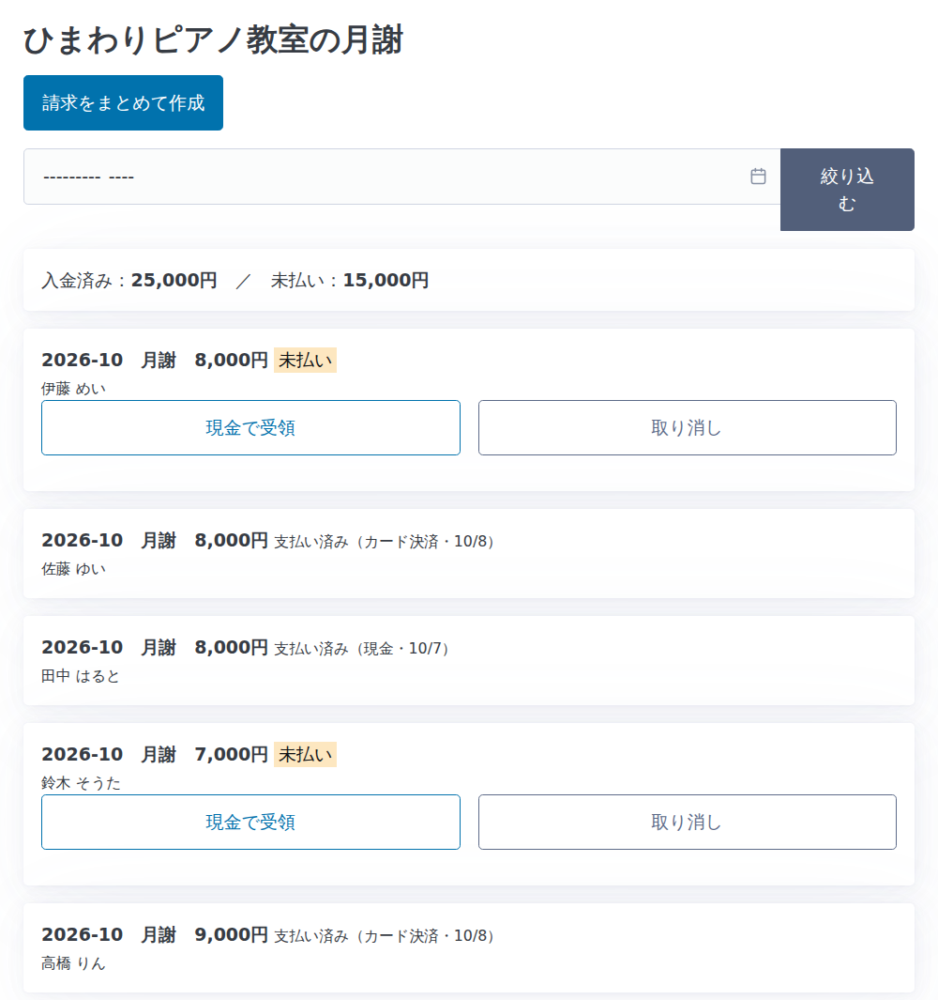
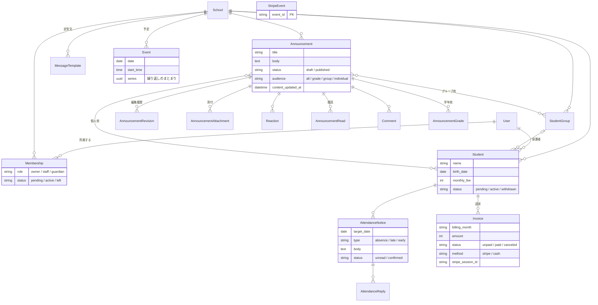

# レッスン管理

習い事の教室と保護者をつなぐ Web アプリです。**お知らせ・出欠連絡・カレンダー・月謝の集金**を、1つの画面で行えます。

> ポートフォリオ作品（2作品目）です。1作品目は Java / Spring Boot で作成し、本作では Python / Django に取り組みました。

## 作った理由

私は習い事の教室を運営する側として、既存の教室管理アプリ（Sgrum）を使っています。便利な一方で、毎日使う中で次の不満がありました。

| 既存アプリで困っていたこと | 本アプリでの解決 |
|---|---|
| お知らせを**公開したあとに編集できない**。誤字や日時の間違いに気づいても、出し直すしかない | 公開後も編集できる。**編集前の内容は履歴に残り**、保護者には「更新あり」と表示される |
| お知らせに**リアクションができない**。保護者が読んだのか、了解したのかが分からない | 👍 🙏 😊 ✅ のリアクションとコメント、**既読・未読の一覧**（未読の保護者が分かる） |
| 出欠連絡に**定型文がない**。保護者も運営者も、毎回同じ文面を手で入力している | 保護者用・運営者の返信用の**定型文をボタン1つで入力**。定型文は教室ごとに編集できる |

「自分が毎日使う立場で、本当に欲しい機能」を基準に設計しました。

## 主な機能

### 運営者（教室）
- **会員管理**：招待リンクの発行、参加申請の承認、会員情報（生年月日・グループ・月謝金額）の編集、退会処理
- **お知らせ**：下書き／公開、公開後の編集と編集履歴、ファイル添付（画像・動画・音声・PDF）、宛先の指定（全体・学年・グループ・個人）、既読確認
- **出欠連絡**：連絡の一覧と確認、定型文での返信、定型文の管理
- **カレンダー**：予定の登録、繰り返し（毎週・隔週・毎月）、出欠連絡のカレンダー表示
- **月謝**：請求の一括作成（会員ごとの金額に対応）、入金状況の集計、現金受領の記録

### 保護者
- 招待リンクから会員登録（子どもの生年月日から**学年を自動表示**。未就学児は年少・年中・年長）
- 自分宛のお知らせの閲覧、リアクション、コメント
- 定型文を使った欠席・遅刻・早退の連絡
- カレンダーの閲覧
- 月謝のカード払い（Stripe Checkout）

## 使用技術

| 分類 | 技術 |
|---|---|
| 言語 | Python 3.14 |
| フレームワーク | Django 6.1 |
| データベース | SQLite（開発用） |
| 決済 | Stripe Checkout、Webhook |
| 画面 | Django テンプレート、Pico CSS |

## 画面

画面に表示されている教室名・氏名・メールアドレスは、すべて説明用の架空のデータです。

### お知らせ（運営者の画面）
公開後に編集すると「編集済み」と表示され、編集前の内容は履歴に残ります。リアクションの数、既読の人数、未読の保護者を確認できます。



### 出欠連絡（保護者の画面）
よく使う文面をボタン1つで入力できます。定型文は教室ごとに編集できます。



### カレンダー
レッスン（毎週の繰り返し）、行事、保護者からの出欠連絡を1つのカレンダーで確認できます。



### 会員管理
学年は保存せず、生年月日から自動で表示します。グループ・月謝金額は会員ごとに設定できます。



### 月謝
請求をまとめて作成し、入金済み・未払いの合計を確認できます。カード決済のほか、現金の受領も記録できます。



## 設計

### アプリの構成

機能ごとに Django アプリを分けています。

| アプリ | 役割 |
|---|---|
| `accounts` | メールアドレスでログインする独自ユーザー |
| `schools` | 教室、所属（権限）、生徒、グループ、学年の計算 |
| `announcements` | お知らせ、編集履歴、リアクション、既読、添付、コメント、宛先 |
| `attendance` | 出欠連絡、返信、定型文 |
| `schedule` | カレンダーの予定、繰り返し |
| `billing` | 請求、Stripe 決済、Webhook |

### ER 図



## 工夫した点

### 1. 教室ごとのデータ分離と権限

複数の教室が同じアプリを使う前提（マルチテナント）で設計しました。

- すべての画面で「その教室に承認済みで所属しているか」を**1つの関数**（`schools/permissions.py`）で判定し、確認漏れを防いでいます。
- データは必ず「自分の教室のもの」「自分が見てよいもの」の中から検索します。URL の ID を書き換えても、他の教室や他の家庭のデータは取得できません。
- 権限がない場合は 403 ではなく **404** を返し、データが存在すること自体を知らせません。
- 保護者には、自分の子どもの出欠連絡・請求と、自分宛のお知らせだけが見えます。

### 2. 決済の安全対策

| 対策 | 理由 |
|---|---|
| カード情報をサーバーで扱わない（Stripe Checkout） | 情報漏えいのリスクを持たないため |
| 支払い完了は Stripe に問い合わせて確認する | 「支払い画面から戻ってきた」だけでは、支払ったとは限らないため |
| Webhook の署名を検証する | 第三者が「支払い済み」の通知を偽装できないようにするため |
| 処理済みのイベント ID を記録する（冪等性） | Stripe は同じ通知を再送することがあるため |
| 金額と通貨を請求と照合する | 違う金額の決済で支払い済みにならないようにするため |
| 有効な支払い画面を使い回す | ボタンを押し直すたびに決済を作ると、二重払いの原因になるため |
| 取り消し・現金受領のときに支払い画面を無効にする | あとからカードでも支払われてしまうのを防ぐため |

### 3. 公開後の編集と「更新あり」

- 編集するたびに、編集前のタイトルと本文を履歴として保存します。添付や宛先の変更も記録します。
- 既読の記録には「最後に読んだ日時」を持たせ、**読んだあとに編集されたお知らせは再び未読**として扱います。
- 保存ボタンを押しただけで内容が変わっていない場合は、履歴も「更新あり」も作りません。

### 4. 学年を保存しない

学年は毎年変わるため、データベースには保存せず、生年月日から表示のたびに計算します（4月始まり、早生まれに対応）。

お知らせを「学年宛」に出すときは、「年長」という名前ではなく**年度が変わっても変わらない番号**で保存しています。こうすることで、今年の年長宛のお知らせは、来年度もその子どもたち（小学1年になった子）に表示され、新しい年長の子には表示されません。

### 5. 添付ファイルの扱い

- 許可する形式を限定し、HTML や SVG など**スクリプトを仕込める形式は拒否**します。
- ファイルは公開フォルダに置かず、お知らせと同じ権限確認を通してから配信します。
- 保存名はランダムにして、同名ファイルの上書きや URL の推測を防いでいます。

### 6. 過去の記録を変えない

- 定型文をあとから書き換えても、過去の出欠連絡の文面は変わりません（文面そのものを保存）。
- 退会は削除ではなく状態の変更で表し、月謝や出欠の履歴を残します。
- 繰り返しの予定は1回ずつ別の行として保存し、「この回だけ休講」「これ以降の時間を変更」に対応しています。

## セットアップ

```bash
git clone <このリポジトリのURL>
cd lesson-app

python -m venv .venv
.venv\Scripts\activate          # Mac / Linux は source .venv/bin/activate
pip install -r requirements.txt

copy .env.example .env          # Mac / Linux は cp。Stripe のテスト用の鍵を記入する
python manage.py migrate
python manage.py createsuperuser
python manage.py runserver
```

1. `http://127.0.0.1:8000/admin` で教室（School）と、自分を運営者とする所属（Membership）を登録します。
2. `http://127.0.0.1:8000/` を開くと、招待リンクが表示されます。別のブラウザでそのリンクを開くと、保護者として登録できます。

Stripe の支払いは、テスト用のカード番号 `4242 4242 4242 4242` で試せます。Webhook をローカルで受け取る場合は、Stripe CLI で次を実行します。

```bash
stripe listen --forward-to 127.0.0.1:8000/stripe/webhook/
```

## 今後の課題

- **自動テストの追加**：権限と決済まわりを中心に整備する
- **教室ごとの入金先**：現在は1つの Stripe アカウントで受け取るため、複数の教室が実際に使うには Stripe Connect への対応が必要
- **通知**：お知らせや出欠連絡があったときに、メールで知らせる
- **1人の子どもに複数の保護者**：現在は子ども1人につき保護者1人
- **本番環境への公開**：PostgreSQL への移行、添付ファイルの外部ストレージ保存
- **教室の新規作成画面**：現在は管理画面から登録する
